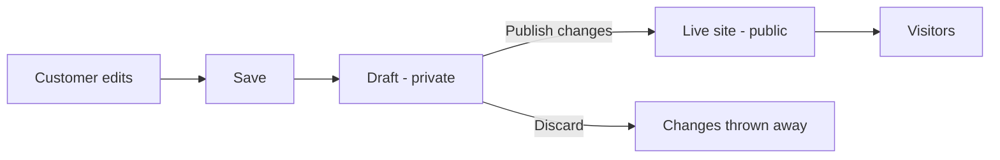

# How a customer's website works

**Who this is for:** anyone at bbloom who needs to explain, support or change
the websites we sell. No programming knowledge assumed.
**What it answers:** what a customer's website is made of, how editing and
publishing work, what they can change about its look, and what their
subscription does and does not affect.

The code is in `src/site/` (the live website) and `src/dashboard/editor/` (the
editing tools). Rules and limits live in
[business-rules.md](https://github.com/Bbloomofficial/bbloom-back/blob/main/docs/business-rules.md).

---

## What a website is made of

A customer's website is not a page someone wrote by hand. It is assembled from
four things, and understanding the four explains almost everything else.

| Piece | What it is |
| --- | --- |
| **Template** | The starting point: which sections a site has, in what order, in what style. Chosen when the site is created. |
| **Sections** | The horizontal bands of the page — the header, the hero banner, the about block, the gallery, the contact form, the footer. |
| **Theme** | The colours, fonts, corner roundness, spacing and visual effects applied across all of it. |
| **Content** | The words, photos, products and contact details the customer supplies. |

A **section** is the unit a customer works with. Each has a **type** — what
kind of band it is — and a **variant** — which layout of that type. A "hero"
section, for example, can be centred, have the image on the right, or run
full-width with text over the photo. Changing the variant changes the layout
without touching the words.

The sections currently available cover: header, announcement bar, hero banner,
features, categories, products, menu, about, gallery, events, credentials,
rates, testimonials, reservations, delivery partners, opening hours, FAQ,
newsletter signup, call-to-action, contact and footer.

### Why a missing section is better than a broken page

The backend can introduce new section types and new layouts without the
frontend being rebuilt. So the renderer has to cope with meeting something it
has never heard of, and it does so deliberately:

- an **unknown layout** falls back to the plainest layout of that section type,
  so the section still appears;
- an **unknown section type** renders **nothing at all** for that section, and
  the rest of the page is unaffected.

That asymmetry is the point. These are live customer websites. A renderer we
forgot to write must cost one missing band, never a blank homepage. Anyone
adding a section type must keep that property.

---

## The draft-then-publish model

**This is the part most often misunderstood, by customers and by staff.**

A customer's website exists in two versions at once:

- the **live** version, which their visitors see;
- the **draft**, which only they see.

Everything they do in the editor goes into the draft. They can rewrite the
whole site over a week, leave it half-finished, come back, change their mind —
and no visitor sees any of it. The live site carries on unchanged.

Pressing **Publish changes** copies the whole draft over the live version in
one go. It publishes **every** saved section, not just the one being looked at.

Four practical consequences:

1. **"I changed it and nothing happened"** almost always means saved but not
   published. The dashboard flags websites with unpublished changes.
2. **Discard throws away everything unpublished**, across all sections, not
   just the current one. It asks for confirmation.
3. **Reset section** is different again: it returns one section to the original
   template wording, losing that customer's edits to it.
4. **Not everything goes through the draft.** Contact details, the address and
   the map link are site settings and save straight away. So do uploaded
   images, which land in the media library immediately.

### Preview

The editor shows the real website in a panel beside the fields, rendered by the
same code that renders it for visitors, so what the customer sees is what
visitors will get.

They can also click straight onto text or a photo in that preview to jump to
the field controlling it. This works by finding, in the rendered page, the
element whose text exactly matches a field's value, and marking it clickable —
which is why it is unobtrusive but also why it does not find a field whose
value appears nowhere visible on screen.

---

## What a customer can change about the look

The theme comes from the backend as part of the site's data. The renderer turns
it into styling; it does not invent it. The adjustable parts cover:

| Area | What it covers |
| --- | --- |
| Colours | Background, surfaces, text, muted text, primary, accent, borders, gradients |
| Typography | Heading and body typefaces, heading weight, and a type scale |
| Shape | Corner roundness, shadow style, density, button style, page width |
| Mode | Light or dark |
| Effects | Glass cards, gradient text, parallax, scroll reveal, hover lift, sticky header, texture overlay, gold dividers |

Georgian fallback fonts are always loaded, whatever typeface is chosen, because
a font that cannot draw Georgian would leave a Georgian business's website in
rectangles.

---

## Photos and media

Pictures a customer uploads are served by the backend, not from the website's
own address. That has one consequence worth knowing because it has caused
several bugs:

> A customer's site may live at `shop.ge` while its photos live at
> `api.bbloom.ge`. Image addresses must therefore be resolved against the
> **API's** address, never the page's. In development the two look the same, so
> a mistake here works perfectly on a laptop and breaks only on a real customer
> domain.

There is one function in the codebase for this, `assetUrl()`. Everything should
use it.

Where a picture is missing, the site draws a tinted placeholder with the first
letter of the alt text rather than a broken-image icon. Galleries open in a
keyboard-navigable lightbox — escape to close, arrows to move.

---

## What visitors can do on the website

| Feature | What it does | When it appears |
| --- | --- | --- |
| Enquiry form | A general message to the business | Where the template has a contact or enquiry band |
| Product enquiry | A question about one specific product | On a product, where products exist |
| Reservation request | Date, time and party size | Where the template has a reservations band |
| Newsletter signup | An email address | Where the template has a newsletter band |
| Buy now | Buy one product directly | Only where ordering is enabled, the product is available, and it has a price |
| Order status | Look up an order with its reference | After a purchase, or by returning to the link |

The first four all land in the customer's dashboard Inbox. **They are not
emailed out.**

**Buy now is a single-product checkout, not a shopping basket.** There is no
basket anywhere in this product. A visitor buys one thing at a time.

---

## Feature gating — what money actually buys

This has changed from the original product, and old assumptions are still in
circulation.

**Publishing a website at a `bbloom.ge` address is free and permanent.** A
subscription is not what puts a site on the internet, and a lapsed one never
takes it off. The only thing between a new customer and a public website is
confirming the email address they signed up with, which is an anti-abuse check.

What a paid subscription buys is a short list of extras:

| Extra | What lapsing does |
| --- | --- |
| Removing the bbloom badge | The badge comes back |
| A custom domain | The domain stops resolving |
| The visitor message form | Stops accepting new messages |

Plus the printable QR card, and — on the appropriate plan — advertising
allowances and the elaborate designs.

Three things stay true when a subscription lapses, and all three are worth
saying out loud to a worried customer:

1. **The website is still up**, still theirs, still showing their phone number
   and address.
2. **Every message already received stays in the inbox** and stays readable.
   The pause is on *new* submissions only.
3. **The customer's own switches are left exactly as they set them**, so the
   form comes back as they left it rather than needing to be found and
   reconfigured.

"Your website is offline" is not a state that exists. Saying it would send
someone into a panic about a shop that is serving fine.

### Design tiers

Templates come in three design tiers — Simple, Classic and Modern — and a plan
declares the **highest tier it unlocks**, with everything below it included.

The frontend's tier checks deliberately **fail open**. If it cannot tell what a
customer is entitled to — the answer is missing, empty, or names something this
build has never heard of — it unlocks everything and lets the server refuse.
The reasoning is that the two mistakes are not equally bad. Showing a design
that turns out to be unavailable costs one refused request, which becomes a
clear upgrade prompt. Locking a design a customer has already paid for leaves
them staring at a padlock on the thing they bought, with no way to prove us
wrong.

The server is always the real gate.

### Changing design is irreversible

Switching a site to a different design is the one customer-facing action with
permanent consequences. Before it happens, the customer is shown exactly what
they will lose — which sections go, which fields are dropped, which features
stop — and must both tick an acknowledgement and confirm.

**Moving away from the Modern design removes order and payment buttons from the
public site.**

---

## Addresses

A customer's website can be reached three ways:

| Address | What it is |
| --- | --- |
| `name.bbloom.ge` | The free subdomain every site gets |
| The customer's own domain | A paid extra; they point their DNS at us |
| `bbloom.ge/site/name` | An internal preview address on the marketing domain |

For custom domains, the frontend does not keep a list. Anything arriving that
is not one of our own addresses is treated as a possible customer site and the
backend decides whether it exists — otherwise every new customer domain would
need a frontend rebuild and redeploy.

The upgrade prompt that appears on some free sites is on a timer: it waits a
while before appearing and, once dismissed, waits again before returning. It is
shown only when the backend's data for that site says so, or when it is forced
with a query parameter for testing.

---

## The try-before-you-buy editor

A prospect can edit a real demo website without an account. What they change is
kept **in their own browser**, not on our servers — photos included, resized
and compressed to fit the browser's storage.

When they sign up, those edits are replayed onto a genuine new site: it is
created from the same template, the edited text is written back section by
section, their photos are uploaded properly, their contact details and social
links are applied, and the site is published.

Two details worth knowing for support:

- Only the fields they **actually changed** are replayed. Everything they left
  alone keeps the template's own wording rather than being blanked.
- If publishing is refused at the last step — an unconfirmed email, most
  likely — the new site is **still created** and kept. The failure is reported,
  not acted on by throwing away their work.
