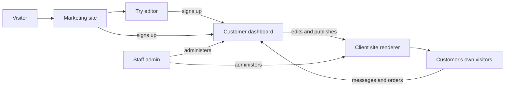

# The five surfaces

**Who this is for:** everyone at bbloom, technical or not.
**What it answers:** this repository builds five different products from one
codebase — what are they, who uses each, and how does an address decide which
one a visitor gets?

## Why this is confusing

Most companies would build five separate websites. bbloom builds one. There is
a single pile of code, a single build, and a single JavaScript bundle shipped
to the browser. When someone opens a page, the code looks at the **address they
typed** and decides which of the five products to become.

That is why a change in this repository can affect something you did not think
you were touching, and why the first question about any change here is always
*"which surface?"*.

## The five, at a glance

| Surface | Where the code lives | Address | Audience |
| --- | --- | --- | --- |
| Marketing site | `src/pages/` | `bbloom.ge` | Prospects and strangers |
| Try editor | `src/try/` | `bbloom.ge/try` | Prospects, no account needed |
| Customer dashboard | `src/dashboard/` | `bbloom.ge/dashboard` and `/s/…` | Paying customers |
| Staff admin | `src/admin/` | `admin.bbloom.ge` (also `bbloom.ge/admin`) | bbloom staff |
| Client site renderer | `src/site/` | `name.bbloom.ge` and customer domains | The customer's own visitors |

Shared pieces that are not a surface of their own: `src/components/` (the
marketing site's shared parts), `src/i18n/` (translations), `src/api/`
(talking to the backend), and `src/theme.tsx` (light and dark mode).

---

## 1. Marketing site — `src/pages/`

The public bbloom.ge: home, services, templates, pricing, about, contact. It is
the only surface a stranger can see without being given an address.

The pricing page does **not** contain prices. It asks the backend for the live
plan list and renders whatever comes back, already translated. Nothing here
decides what bbloom charges. See
[business-rules.md](https://github.com/Bbloomofficial/bbloom-back/blob/main/docs/business-rules.md).

Signing in and signing up are a **dialog that opens over the page you were
reading** rather than pages of their own, but `/login` and `/register` are
still real addresses, because both appear in email that has already been sent.

## 2. Try editor — `src/try/`

A prospect can edit a real demo website — change the business name, the
headings, the photos — without creating an account. The edits are kept in their
own browser, not on our servers.

If they then sign up, those edits are replayed onto a genuine new site: the
site is created from the same template, the edited text is written back, the
photos they chose are uploaded, and the site is published. Nothing is lost in
the handover, and nothing was stored on our side before they agreed to it.

This surface exists to answer one objection — *"I don't know what my site would
look like"* — before anyone is asked for money.

## 3. Customer dashboard — `src/dashboard/`

Where a customer runs their own website: edit the pages, read messages from
visitors, see their ads, manage billing, invite a colleague.

Two things about its addresses are worth knowing:

- It is a **page on the marketing site**, not a separate website. `/` is always
  the public bbloom.ge pitch, even for a signed-in customer. Their websites are
  at `/dashboard`.
- Its screens sit at the top level — `/s/{site}/inbox`, `/account`, `/new` —
  rather than under `/dashboard/`. That is not cosmetic: the backend builds the
  "you have a new enquiry" email links against those exact paths, so moving
  them would break email that is already in people's inboxes.

`panel.bbloom.ge` was the dashboard's old home. It now forwards to the new
addresses path-for-path, so old bookmarks still work.

Full walkthrough: [dashboard-guide.md](dashboard-guide.md).

## 4. Staff admin — `src/admin/`

The bbloom team's console: customer accounts, every site, plans and prices,
promo codes, advertising campaigns, and outgoing-mail health.

It has its own address, `admin.bbloom.ge`, and also answers at `bbloom.ge/admin`
so older links keep working. The code builds every internal link through a
helper so the same link renders correctly on both.

Full walkthrough, including the destructive actions:
[admin-guide.md](admin-guide.md).

## 5. Client site renderer — `src/site/`

This is the product bbloom actually sells. It renders the customer's own
website: their branding, their products, their contact form, on their own
address.

It is the only surface whose visitors have never heard of bbloom.

Full explanation of templates, publishing and theming:
[client-sites.md](client-sites.md).

---

## The blast radius of `src/site/`

**`src/site/` is the most sensitive directory in this repository.**

Every paying customer's live website is rendered by this code. A change here:

- reaches **every customer** on the next deploy to `main`;
- has **no per-customer opt-out** and no staged rollout;
- is visible to **the customer's own visitors**, not to bbloom staff, so we are
  usually not the first to notice when it is wrong;
- is deployed on **any** push to `main` — the deploy workflow is not filtered by
  path, so even a documentation-only commit rebuilds and redeploys production.

A visible consequence of that risk is built into the code. The renderer maps
each published section to a component and, if it meets a section layout it does
not recognise, falls back to the plainest version of that section. If it meets
a section **type** it has never heard of, it renders nothing at all for that
section and leaves the rest of the page intact. This is deliberate: a renderer
we forgot to write must cost one missing section, never a customer's entire
homepage going blank. Any new section type must keep that property.

## How an address picks a surface

Roughly, in the order the code asks:

1. Is the hostname `admin.bbloom.ge`? → **staff admin**.
2. Is the hostname `panel.bbloom.ge`? → forward to the dashboard's new address.
3. Is the hostname something other than ours — a customer subdomain like
   `marita.bbloom.ge`, or a customer's own domain? → **client site renderer**.
4. Does the path belong to the dashboard (`/dashboard`, `/s/…`, `/account`,
   `/new`)? → **customer dashboard**.
5. Is the path `/try/…`? → **try editor**.
6. Otherwise → **marketing site**.

Two details in step 3 matter in practice.

**The rule is inverted on purpose.** Anything that is not recognisably one of
*our* hostnames is treated as a customer site, and the backend decides whether
it really exists. The alternative — listing customer domains in the code —
would mean rebuilding and redeploying the whole frontend every time a customer
points a new domain at us, which is a thing this business does routinely.

**A short list of names is reserved** so that a customer cannot take over a
surface visitors read as bbloom speaking. The reserved labels live in
`src/site/host.ts`.

## How the surfaces relate

The loop that matters commercially: a customer edits in the **dashboard**, the
result appears on their **site**, their visitors send messages and orders
through that site, and those land back in the **dashboard** inbox.

## Where to go next

- A customer asks "what can I do?" → [dashboard-guide.md](dashboard-guide.md)
- A new staff member needs training → [admin-guide.md](admin-guide.md)
- Someone asks how publishing works → [client-sites.md](client-sites.md)
- You are about to write code → [frontend-dev.md](frontend-dev.md)
- You need a rule, limit or price →
  [business-rules.md](https://github.com/Bbloomofficial/bbloom-back/blob/main/docs/business-rules.md)
